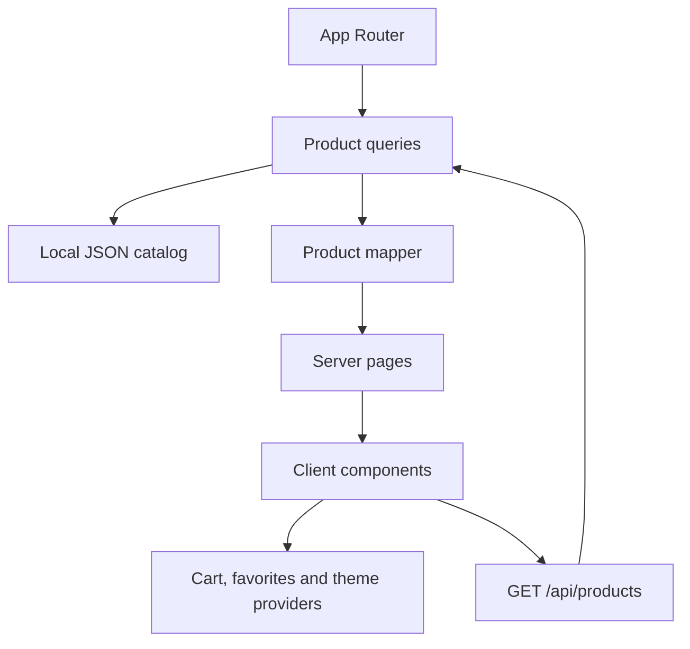

# Arquitetura e manutenção

Este documento descreve as fronteiras do projeto e os contratos que devem ser preservados durante a refatoração incremental.

## Visão geral

O projeto usa Next.js App Router, React, TypeScript e dados locais em JSON. As rotas de página compõem a interface; a camada de dados lê e transforma o catálogo; providers e hooks conectam interações do navegador aos componentes.



## Fronteiras

- `src/app` contém rotas, layouts e a API. Uma rota de servidor deve compor dados e passar apenas as props necessárias para um componente cliente.
- `src/lib` contém consultas, ordenação, paginação, formatação e regras puras. Componentes não devem importar JSON diretamente.
- `src/data` é a fonte local do catálogo. `products.json` contém os resumos do catálogo; os arquivos de categoria contêm os detalhes.
- `src/context` contém apenas estado global de carrinho, favoritos e tema. A persistência fica atrás de um adaptador para que falhas do navegador não derrubem a interface.
- `src/hooks` conecta estado, URL, navegação e efeitos do navegador. Algoritmos reutilizáveis devem permanecer em funções puras em `src/lib`.
- `src/components` contém componentes de domínio e componentes básicos. Componentes básicos não conhecem Context API nem carregam dados do catálogo.

## Contratos de dados

- `itemId` é a identidade persistida do carrinho e dos favoritos. Não substitua esse valor por um índice da lista.
- IDs numéricos e anos usados nos resumos devem vir do catálogo validado. Fallbacks silenciosos para zero ou anos inventados escondem inconsistências.
- Preços exibidos vêm dos detalhes (`priceRegular` e `priceDiscount`). Os resumos fornecem os metadados necessários para o catálogo.
- Quantidades do carrinho são inteiros positivos. Conteúdo inválido do armazenamento é descartado e não deve impedir o uso em memória.
- A API `GET /api/products` deve retornar uma lista, `total`, `page`, `pageSize`, `totalPages` e `hasMore`. Parâmetros inválidos usam defaults seguros.

## Componentes reutilizáveis

Antes de criar uma abstração, confirme que existe comportamento compartilhado e um contrato estável.

- Ações de carrinho e favoritos devem ser componentes controlados por props, com labels acessíveis e estado pressionado quando aplicável.
- Diálogos devem possuir título, descrição, foco inicial, ciclo de Tab, Escape e retorno do foco ao acionador.
- Navegação móvel deve fechar ao navegar ou trocar para desktop e restaurar o scroll anterior.
- Paginação recebe apenas `currentPage`, `totalPages` e `onPageChange(page)`. Eventos de uma biblioteca visual não fazem parte do contrato de domínio.

## Validação

O workflow de qualidade executa:

```bash
npm ci
npm run validate:data
npm run lint
npx tsc --noEmit
npm run build
```

Cada nova regra pura deve ter um teste de contrato executável pelo Node Test Runner quando o comportamento não puder ser garantido pelo TypeScript ou pelo build. O teste deve falhar para o caso inválido antes da implementação e cobrir a regra, não repetir a implementação.

## UI/UX e auditoria pendente

A análise inicial identificou riscos de foco, scroll, ações ambíguas, textos mistos e parâmetros de URL. A auditoria visual ainda precisa ser executada no navegador com capturas de:

- início e catálogo em desktop e celular;
- detalhes com variantes de cor e armazenamento;
- carrinho vazio, carrinho com itens e diálogo aberto;
- favoritos;
- menu móvel aberto, fechado e durante mudança de viewport;
- temas claro e escuro;
- navegação por teclado e foco visível.

Registre no PR o viewport, o cenário, o comportamento observado e a captura correspondente. Não declare contraste, responsividade ou sobreposição como validados apenas por leitura estática.

## Limites conhecidos

Este é um front-end de demonstração. Não há autenticação, banco, checkout real ou sincronização entre dispositivos. A persistência depende do armazenamento do navegador e pode ficar somente em memória quando ele estiver bloqueado.

As PRs de implementação são mantidas separadas para reduzir conflitos. Ao integrar uma PR empilhada sobre `chore/quality-checks`, retargete-a para `develop` e confira novamente o diff e o CI.
